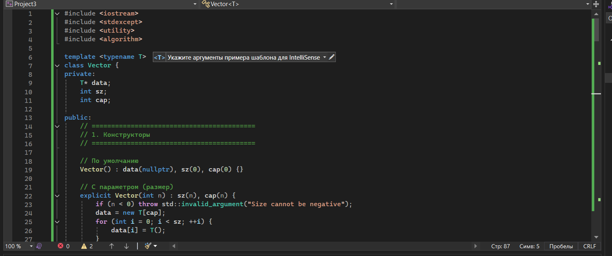
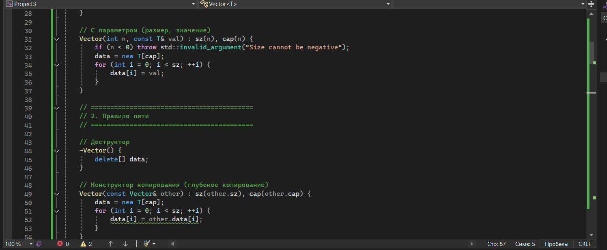
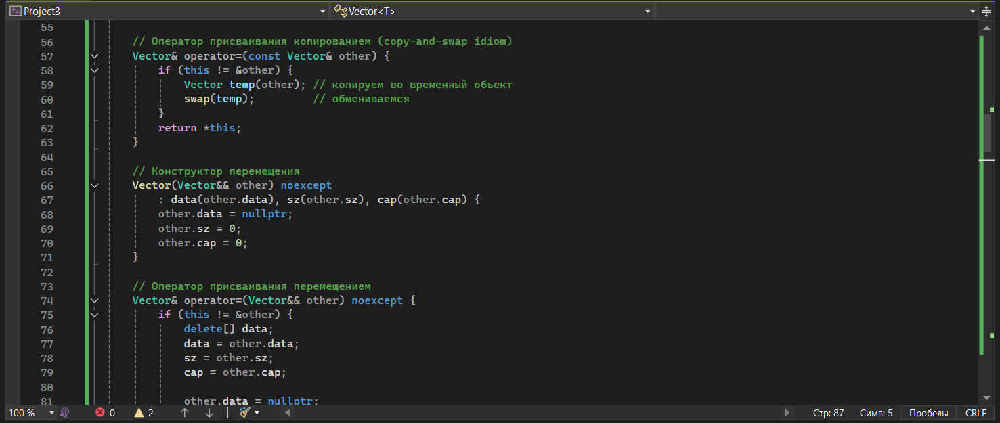
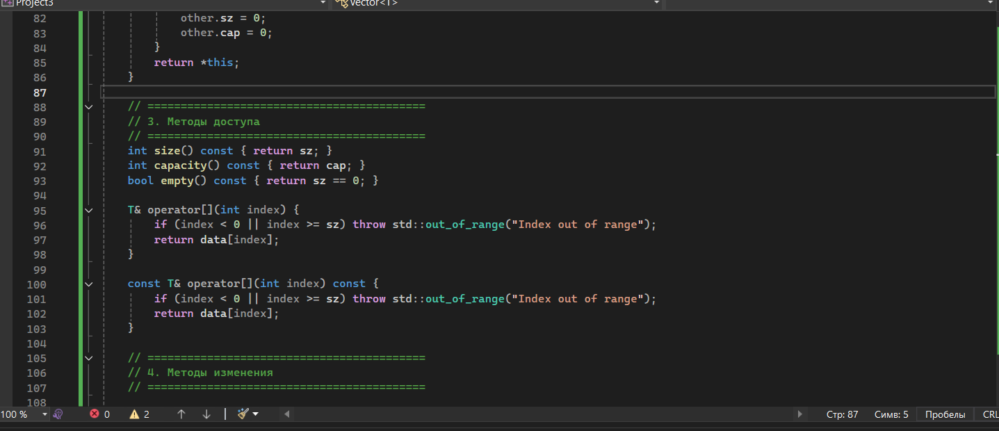
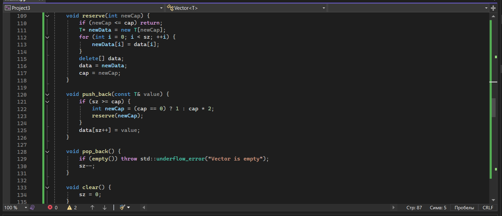
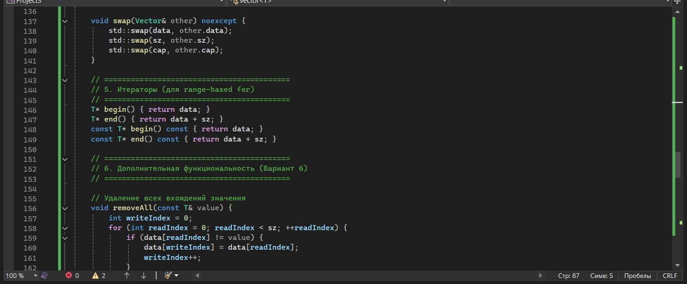
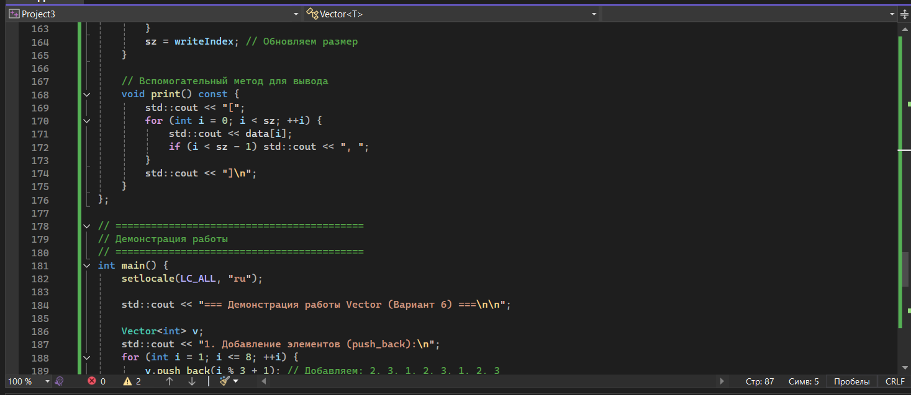
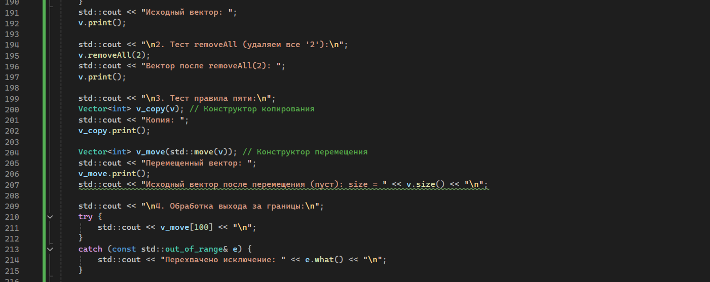
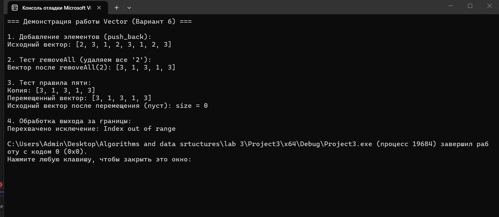

МИНИCTEPCTBO НАУКИ И ВЫСШЕГО ОБРАЗОВАНИЯ РОССИЙСКОЙ ФЕДЕРАЦИИ
Федеральное государственное автономное
образовательное учреждение высшего образования
«СЕВЕРО-КАВКАЗСКИЙ ФЕДЕРАЛЬНЫЙ УНИВЕРСИТЕТ»
Институт перспективной инженерии
Департамент цифровых, робототехнических систем и электроники
Межинститутская базовая кафедра 

Отчет по лабораторной работе № 3
Вариант 6
Тема: «Реализация динамического массива (аналог vector). Итераторы»
Дисциплина: «Алгоритмы и структуры данных»

Выполнил: 
Студент группы ПИЖ-б-о-25-2 (1),
направление подготовки: 09.03.04 «Программная инженерия»
Гетогазов Мухаммад Умарович 
Проверил: 
Ассистент межинститутской базовой кафедры ДЦРСиЭ 
Белик.А.И

Ставрополь 2025 

#include <iostream>
#include <stdexcept>
#include <utility>
#include <algorithm>

template <typename T>
class Vector {
private:
    T* data;
    int sz;
    int cap;

public:
    // ==========================================
    // 1. Конструкторы
    // ==========================================

    // По умолчанию
    Vector() : data(nullptr), sz(0), cap(0) {}

    // С параметром (размер)
    explicit Vector(int n) : sz(n), cap(n) {
        if (n < 0) throw std::invalid_argument("Size cannot be negative");
        data = new T[cap];
        for (int i = 0; i < sz; ++i) {
            data[i] = T();
        }
    }

    // С параметром (размер, значение)
    Vector(int n, const T& val) : sz(n), cap(n) {
        if (n < 0) throw std::invalid_argument("Size cannot be negative");
        data = new T[cap];
        for (int i = 0; i < sz; ++i) {
            data[i] = val;
        }
    }

    // ==========================================
    // 2. Правило пяти
    // ==========================================

    // Деструктор
    ~Vector() {
        delete[] data;
    }

    // Конструктор копирования (глубокое копирование)
    Vector(const Vector& other) : sz(other.sz), cap(other.cap) {
        data = new T[cap];
        for (int i = 0; i < sz; ++i) {
            data[i] = other.data[i];
        }
    }

    // Оператор присваивания копированием (copy-and-swap idiom)
    Vector& operator=(const Vector& other) {
        if (this != &other) {
            Vector temp(other); // копируем во временный объект
            swap(temp);         // обмениваемся
        }
        return *this;
    }

    // Конструктор перемещения
    Vector(Vector&& other) noexcept
        : data(other.data), sz(other.sz), cap(other.cap) {
        other.data = nullptr;
        other.sz = 0;
        other.cap = 0;
    }

    // Оператор присваивания перемещением
    Vector& operator=(Vector&& other) noexcept {
        if (this != &other) {
            delete[] data;
            data = other.data;
            sz = other.sz;
            cap = other.cap;

            other.data = nullptr;
            other.sz = 0;
            other.cap = 0;
        }
        return *this;
    }

    // ==========================================
    // 3. Методы доступа
    // ==========================================
    int size() const { return sz; }
    int capacity() const { return cap; }
    bool empty() const { return sz == 0; }

    T& operator {
        if (index < 0 || index >= sz) throw std::out_of_range("Index out of range");
        return data[index];
    }

    const T& operator const {
        if (index < 0 || index >= sz) throw std::out_of_range("Index out of range");
        return data[index];
    }

    // ==========================================
    // 4. Методы изменения
    // ==========================================

    void reserve(int newCap) {
        if (newCap <= cap) return;
        T* newData = new T[newCap];
        for (int i = 0; i < sz; ++i) {
            newData[i] = data[i];
        }
        delete[] data;
        data = newData;
        cap = newCap;
    }

    void push_back(const T& value) {
        if (sz >= cap) {
            int newCap = (cap == 0) ? 1 : cap * 2;
            reserve(newCap);
        }
        data[sz++] = value;
    }

    void pop_back() {
        if (empty()) throw std::underflow_error("Vector is empty");
        sz--;
    }

    void clear() {
        sz = 0;
    }

    void swap(Vector& other) noexcept {
        std::swap(data, other.data);
        std::swap(sz, other.sz);
        std::swap(cap, other.cap);
    }

    // ==========================================
    // 5. Итераторы (для range-based for)
    // ==========================================
    T* begin() { return data; }
    T* end() { return data + sz; }
    const T* begin() const { return data; }
    const T* end() const { return data + sz; }

    // ==========================================
    // 6. Дополнительная функциональность (Вариант 6)
    // ==========================================

    // Удаление всех вхождений значения
    void removeAll(const T& value) {
        int writeIndex = 0;
        for (int readIndex = 0; readIndex < sz; ++readIndex) {
            if (data[readIndex] != value) {
                data[writeIndex] = data[readIndex];
                writeIndex++;
            }
        }
        sz = writeIndex; // Обновляем размер
    }

    // Вспомогательный метод для вывода
    void print() const {
        std::cout << "[";
        for (int i = 0; i < sz; ++i) {
            std::cout << data[i];
            if (i < sz - 1) std::cout << ", ";
        }
        std::cout << "]\n";
    }
};

// ==========================================
// Демонстрация работы
// ==========================================
int main() {
    setlocale(LC_ALL, "ru");

    std::cout << "=== Демонстрация работы Vector (Вариант 6) ===\n\n";

    Vector<int> v;
    std::cout << "1. Добавление элементов (push_back):\n";
    for (int i = 1; i <= 8; ++i) {
        v.push_back(i % 3 + 1); // Добавляем: 2, 3, 1, 2, 3, 1, 2, 3
    }
    std::cout << "Исходный вектор: ";
    v.print();

    std::cout << "\n2. Тест removeAll (удаляем все '2'):\n";
    v.removeAll(2);
    std::cout << "Вектор после removeAll(2): ";
    v.print();

    std::cout << "\n3. Тест правила пяти:\n";
    Vector<int> v_copy(v); // Конструктор копирования
    std::cout << "Копия: ";
    v_copy.print();

    Vector<int> v_move(std::move(v)); // Конструктор перемещения
    std::cout << "Перемещенный вектор: ";
    v_move.print();
    std::cout << "Исходный вектор после перемещения (пуст): size = " << v.size() << "\n";

    std::cout << "\n4. Обработка выхода за границы:\n";
    try {
        std::cout << v_move[100] << "\n";
    }
    catch (const std::out_of_range& e) {
        std::cout << "Перехвачено исключение: " << e.what() << "\n";
    }

    return 0;
}

Скрины кода 

Контрольные вопросы 
Почему динамический массив называется «динамическим»?
Потому что его размер определяется во время выполнения программы (динамически), а не на этапе компиляции, и он может изменяться (расширяться/сужаться) по мере необходимости. Память при этом выделяется в куче (heap).

Что такое ёмкость (capacity) и чем она отличается от размера (size)?
size — количество реально хранящихся элементов в векторе. capacity — количество памяти, выделенной под элементы. capacity всегда 
≥
≥ size. Память выделяется с запасом, чтобы избежать частых переаллокаций.

Почему при расширении массива ёмкость удваивается, а не увеличивается на фиксированное число?
При увеличении на константу (например, +1) сложность push_back становится 
O
(
N
)
O(N) в среднем (так как перевыделение будет происходить на каждом шаге), а общая сложность заполнения 
N
N элементов составит 
O
(
N
2
)
O(N 
2
 ). Удвоение обеспечивает амортизированную сложность 
O
(
1
)
O(1) для push_back и общую сложность 
O
(
N
)
O(N).

Какова амортизированная сложность операции push_back? Почему?
Амортизированная сложность — O(1). Хотя иногда происходит расширение за 
O
(
N
)
O(N), редкие дорогие операции «размазываются» по множеству дешевых операций. Суммарное время на вставку 
N
N элементов составляет 
O
(
N
)
O(N), следовательно, на одну операцию в среднем 
O
(
1
)
O(1).

Что такое «правило трёх»? Когда оно применяется?
Если класс управляет ресурсами (например, динамической памятью), и вам пришлось написать хотя бы один из трех методов: деструктор, конструктор копирования или оператор присваивания копированием, — то вам, скорее всего, нужно написать и два остальных. Применяется для предотвращения утечек памяти и двойного удаления (double free).

Что такое «правило пяти»? Чем оно отличается от «правила трёх»?
Это расширение «правила трёх» с добавлением семантики перемещения: конструктор перемещения и оператор присваивания перемещением. Это позволяет избежать дорогостоящего глубокого копирования при передаче временных объектов (rvalue).

В чем разница между конструктором копирования и оператором присваивания?
Конструктор копирования создает новый объект на основе существующего. Оператор присваивания изменяет уже существующий объект (предварительно освободив его старые ресурсы).

Зачем нужна проверка if (this != &other) в операторе присваивания?
Для защиты от самоприсваивания (например, v = v;). Без этой проверки мы могли бы удалить свои же данные (delete[] data) до того, как скопируем их из other, что привело бы к чтению из освобожденной памяти.

Что такое итератор? Как он связан с указателем?
Итератор — это объект, который предоставляет доступ к элементам контейнера и позволяет перебирать их. В простейшем случае (как в Vector) итератор — это обычный указатель (T*).

Зачем нужны методы begin() и end()?
Они определяют диапазон элементов контейнера. begin() указывает на первый элемент, end() — на элемент, следующий за последним. Это стандартный интерфейс для работы с алгоритмами STL и цикла range-based for.

Как реализовать range-based for для своего контейнера?
Нужно реализовать методы begin() и end() (возвращающие итераторы), как для константного, так и для неконстантного объекта. Цикл for (auto x : v) автоматически развернется в цикл с использованием этих методов.

Что такое «глубокое копирование»? Чем оно отличается от «поверхностного»?
Глубокое копирование создает полностью независимую копию данных (выделяет новую память и копирует туда значения). Поверхностное копирование копирует только указатели, из-за чего два объекта начинают указывать на одну и ту же область памяти (что приводит к ошибкам при удалении).

Что такое семантика перемещения и зачем она нужна?
Это механизм, позволяющий «забрать» ресурсы у временного объекта (rvalue), а не копировать их. Это нужно для повышения производительности (например, при возврате вектора из функции не происходит 
O
(
N
)
O(N) копирование).

Почему конструктор перемещения помечается noexcept?
Стандартные контейнеры (например, std::vector) при перевыделении памяти используют перемещение только в том случае, если конструктор перемещения гарантирует отсутствие исключений (noexcept). Если он может выбросить исключение, контейнеры используют копирование для обеспечения строгой гарантии безопасности исключений.

Как правильно освобождать память в деструкторе?
Для массивов, выделенных через new[], использовать delete[] data;. Обязательно проверять, что указатель не равен nullptr, хотя стандартный delete[] nullptr безопасен.

