МИНИCTEPCTBO НАУКИ И ВЫСШЕГО ОБРАЗОВАНИЯ РОССИЙСКОЙ ФЕДЕРАЦИИ
Федеральное государственное автономное
образовательное учреждение высшего образования
«СЕВЕРО-КАВКАЗСКИЙ ФЕДЕРАЛЬНЫЙ УНИВЕРСИТЕТ»
Институт перспективной инженерии
Департамент цифровых, робототехнических систем и электроники
Межинститутская базовая кафедра 

Отчет по лабораторной работе № 4
Вариант 6
Тема: «Односвязный и двусвязный списки»
Дисциплина: «Алгоритмы и структуры данных»

Выполнил: 
Студент группы ПИЖ-б-о-25-2 (1),
направление подготовки: 09.03.04 «Программная инженерия»
Гетогазов Мухаммад Умарович 
Проверил: 
Ассистент межинститутской базовой кафедры ДЦРСиЭ 
Белик.А.И

Ставрополь 2025 

#include <iostream>
#include <stdexcept>

// ==========================================
// ОДНОСВЯЗНЫЙ СПИСОК (SinglyLinkedList)
// ==========================================
template <typename T>
class SinglyLinkedList {
private:
    struct Node {
        T data;
        Node* next;
        Node(const T& value) : data(value), next(nullptr) {}
    };
    Node* head;
    Node* tail;
    int count;

public:
    SinglyLinkedList() : head(nullptr), tail(nullptr), count(0) {}
    ~SinglyLinkedList() { clear(); }

    // Вставка в начало O(1)
    void push_front(const T& value) {
        Node* newNode = new Node(value);
        newNode->next = head;
        head = newNode;
        if (tail == nullptr) tail = newNode;
        count++;
    }

    // Вставка в конец O(1) с tail
    void push_back(const T& value) {
        Node* newNode = new Node(value);
        if (head == nullptr) {
            head = tail = newNode;
        }
        else {
            tail->next = newNode;
            tail = newNode;
        }
        count++;
    }

    // Удаление из начала O(1)
    void pop_front() {
        if (head == nullptr) throw std::underflow_error("List is empty");
        Node* temp = head;
        head = head->next;
        delete temp;
        count--;
        if (head == nullptr) tail = nullptr;
    }

    // Удаление из конца O(n)
    void pop_back() {
        if (head == nullptr) throw std::underflow_error("List is empty");
        if (head->next == nullptr) {
            delete head;
            head = tail = nullptr;
        }
        else {
            Node* current = head;
            while (current->next != tail) {
                current = current->next;
            }
            delete tail;
            tail = current;
            tail->next = nullptr;
        }
        count--;
    }

    // Поиск O(n)
    Node* find(const T& value) const {
        Node* current = head;
        while (current != nullptr) {
            if (current->data == value) return current;
            current = current->next;
        }
        return nullptr;
    }

    // Дополнительное задание (Вариант 6): Циклический сдвиг влево на k позиций O(n)
    void rotateLeft(int k) {
        if (head == nullptr || head->next == nullptr || k <= 0) return;

        k = k % count; // Если k больше размера списка
        if (k == 0) return;

        Node* current = head;
        int steps = 1;
        // Находим новый хвост (узел перед новым head)
        while (steps < k) {
            current = current->next;
            steps++;
        }

        Node* newHead = current->next;
        Node* newTail = current;

        // Замыкаем список в кольцо и разрываем в нужном месте
        newTail->next = nullptr;
        tail->next = head;
        head = newHead;
        tail = newTail;
    }

    void print() const {
        Node* current = head;
        std::cout << "[";
        while (current != nullptr) {
            std::cout << current->data;
            if (current->next != nullptr) std::cout << ", ";
            current = current->next;
        }
        std::cout << "]" << std::endl;
    }

    void clear() {
        while (head != nullptr) {
            Node* temp = head;
            head = head->next;
            delete temp;
        }
        tail = nullptr;
        count = 0;
    }

    int size() const { return count; }
    bool empty() const { return head == nullptr; }
};

// ==========================================
// ДВУСВЯЗНЫЙ СПИСОК (DoublyLinkedList)
// ==========================================
template <typename T>
class DoublyLinkedList {
private:
    struct DNode {
        T data;
        DNode* prev;
        DNode* next;
        DNode(const T& value) : data(value), prev(nullptr), next(nullptr) {}
    };
    DNode* head;
    DNode* tail;
    int count;

public:
    DoublyLinkedList() : head(nullptr), tail(nullptr), count(0) {}
    ~DoublyLinkedList() { clear(); }

    // Вставка в начало O(1)
    void push_front(const T& value) {
        DNode* newNode = new DNode(value);
        if (head == nullptr) {
            head = tail = newNode;
        }
        else {
            newNode->next = head;
            head->prev = newNode;
            head = newNode;
        }
        count++;
    }

    // Вставка в конец O(1)
    void push_back(const T& value) {
        DNode* newNode = new DNode(value);
        if (tail == nullptr) {
            head = tail = newNode;
        }
        else {
            tail->next = newNode;
            newNode->prev = tail;
            tail = newNode;
        }
        count++;
    }

    // Удаление из начала O(1)
    void pop_front() {
        if (head == nullptr) throw std::underflow_error("List is empty");
        DNode* temp = head;
        head = head->next;
        if (head != nullptr) head->prev = nullptr;
        else tail = nullptr;
        delete temp;
        count--;
    }

    // Удаление из конца O(1)
    void pop_back() {
        if (tail == nullptr) throw std::underflow_error("List is empty");
        DNode* temp = tail;
        tail = tail->prev;
        if (tail != nullptr) tail->next = nullptr;
        else head = nullptr;
        delete temp;
        count--;
    }

    // Поиск O(n)
    DNode* find(const T& value) const {
        DNode* current = head;
        while (current != nullptr) {
            if (current->data == value) return current;
            current = current->next;
        }
        return nullptr;
    }

    // Дополнительное задание (Вариант 6): Циклический сдвиг влево на k позиций O(n)
    void rotateLeft(int k) {
        if (head == nullptr || head->next == nullptr || k <= 0) return;

        k = k % count;
        if (k == 0) return;

        DNode* current = head;
        int steps = 1;
        while (steps < k) {
            current = current->next;
            steps++;
        }

        DNode* newTail = current;
        DNode* newHead = current->next;

        // Обновляем указатели next
        newTail->next = nullptr;
        tail->next = head;

        // Обновляем указатели prev
        head->prev = tail;
        newHead->prev = nullptr;

        // Обновляем head и tail
        head = newHead;
        tail = newTail;
    }

    void print() const {
        DNode* current = head;
        std::cout << "[";
        while (current != nullptr) {
            std::cout << current->data;
            if (current->next != nullptr) std::cout << ", ";
            current = current->next;
        }
        std::cout << "]" << std::endl;
    }

    void printReverse() const {
        DNode* current = tail;
        std::cout << "[";
        while (current != nullptr) {
            std::cout << current->data;
            if (current->prev != nullptr) std::cout << ", ";
            current = current->prev;
        }
        std::cout << "]" << std::endl;
    }

    void clear() {
        while (head != nullptr) {
            DNode* temp = head;
            head = head->next;
            delete temp;
        }
        tail = nullptr;
        count = 0;
    }

    int size() const { return count; }
    bool empty() const { return head == nullptr; }
};

// ==========================================
// ДЕМОНСТРАЦИОННАЯ ПРОГРАММА
// ==========================================
int main() {
    setlocale(LC_ALL, "ru");

    std::cout << "=== Односвязный список (SinglyLinkedList) ===" << std::endl;
    SinglyLinkedList<int> sList;
    sList.push_back(1);
    sList.push_back(2);
    sList.push_back(3);
    sList.push_back(4);
    sList.push_back(5);

    std::cout << "Исходный список: ";
    sList.print();

    int k_s = 2;
    std::cout << "После rotateLeft(" << k_s << "): ";
    sList.rotateLeft(k_s);
    sList.print();
    std::cout << std::endl;

    std::cout << "=== Двусвязный список (DoublyLinkedList) ===" << std::endl;
    DoublyLinkedList<int> dList;
    dList.push_back(10);
    dList.push_back(20);
    dList.push_back(30);
    dList.push_back(40);
    dList.push_back(50);

    std::cout << "Исходный список (прямой): ";
    dList.print();
    std::cout << "Исходный список (обратный): ";
    dList.printReverse();

    int k_d = 3;
    std::cout << "После rotateLeft(" << k_d << "): ";
    dList.rotateLeft(k_d);
    dList.print();

    std::cout << "Проверка обратного вывода после сдвига: ";
    dList.printReverse();

    return 0;
}

Скрины кода 
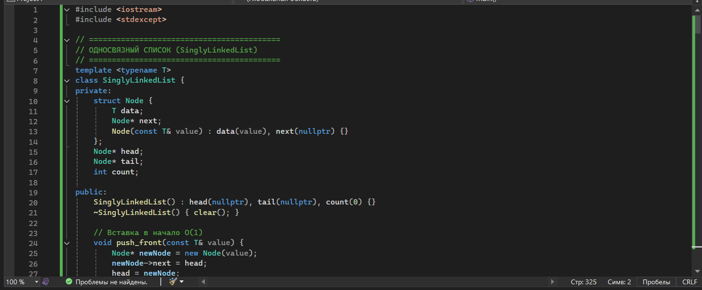
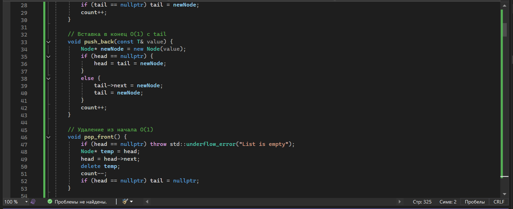
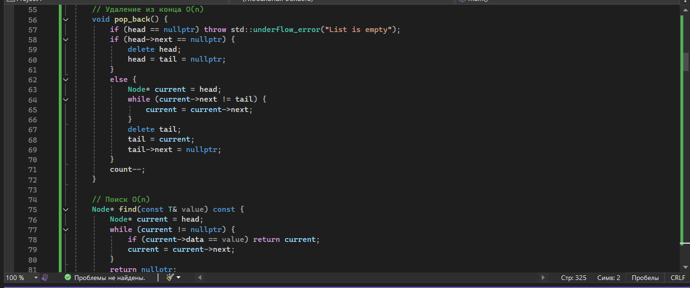
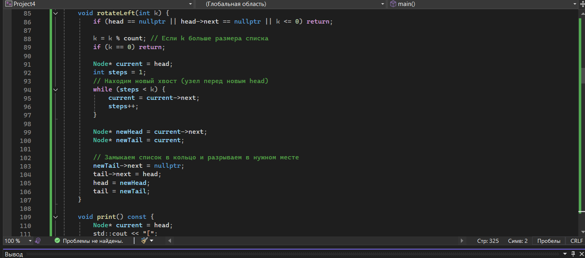
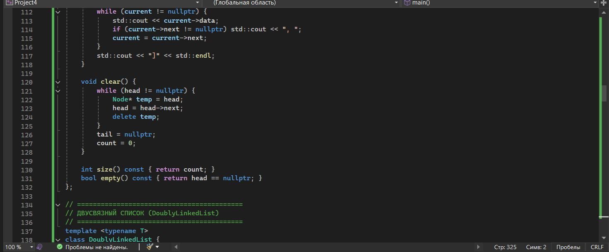
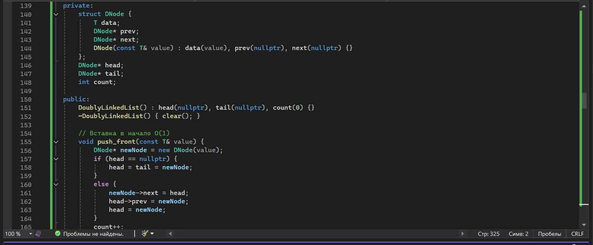
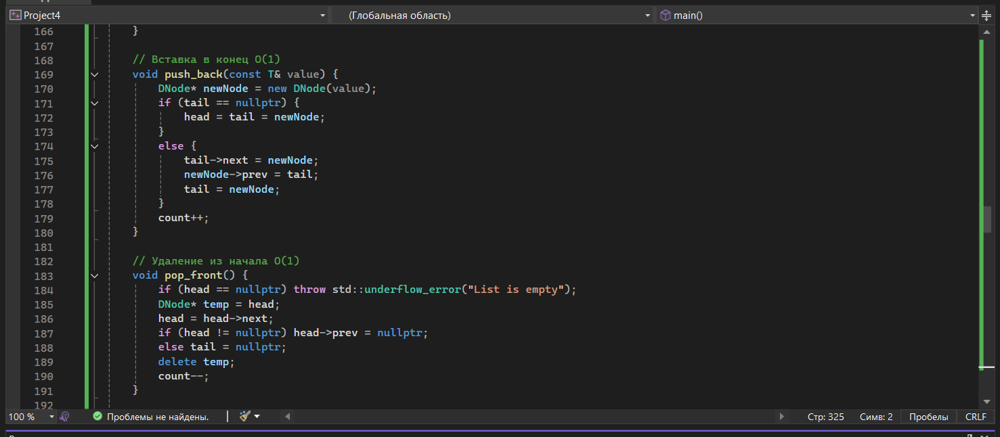
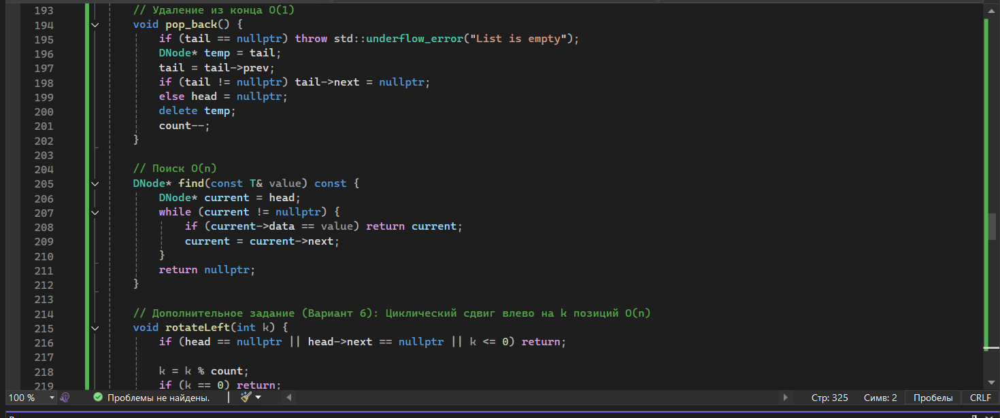
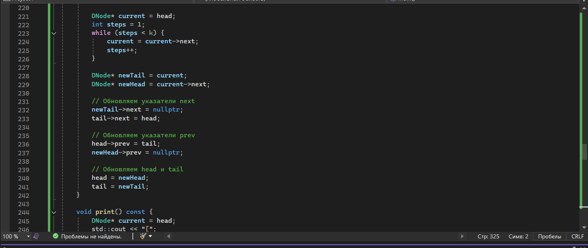
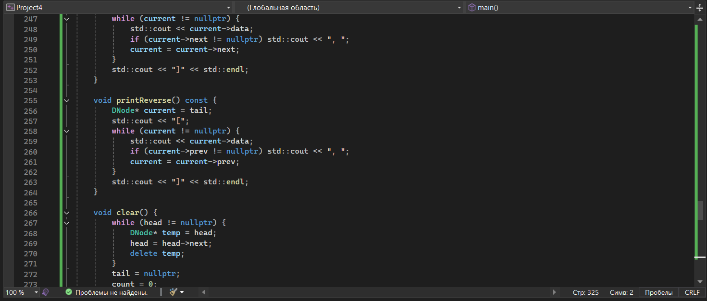
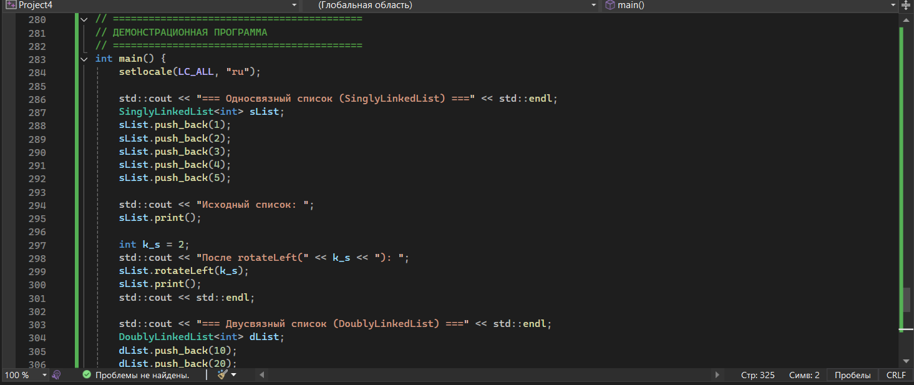
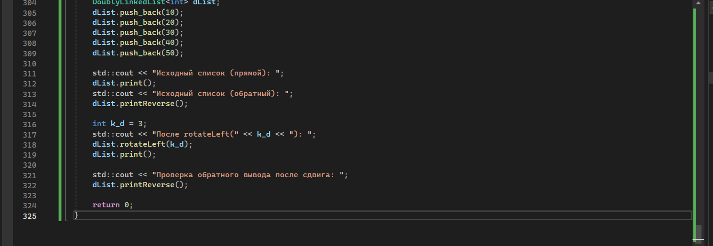
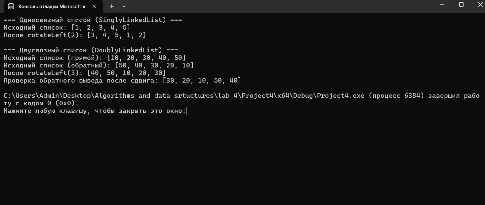

Контрольные вопросы 
1. Чем связный список отличается от динамического массива?

Ответ: Динамический массив хранит элементы в непрерывной области памяти, что обеспечивает быстрый доступ по индексу за O(1), но требует перевыделения памяти и копирования при вставке/удалении в середину (O(n)). Связный список состоит из узлов, разбросанных по памяти, которые связаны указателями. Доступ по индексу здесь занимает O(n), зато вставка и удаление (при наличии указателя на место) выполняются за O(1), а память выделяется только под фактически добавленные элементы.

2. Какие операции в односвязном списке выполняются за O(1)?

Ответ:

Вставка в начало (push_front).

Удаление из начала (pop_front).

Вставка в конец (push_back), если хранится указатель на хвост (tail).

Вставка после заданного узла.

Удаление узла, следующего за заданным.

3. Почему удаление из конца односвязного списка требует O(n) времени?

Ответ: Потому что в односвязном списке у нас есть указатели только на следующий элемент. Чтобы удалить последний узел, нам нужно изменить указатель next у предпоследнего узла на nullptr. Так как мы не можем перейти от конца к началу (нет указателя prev), нам приходится начинать с head и проходить весь список, чтобы найти предпоследний элемент.

4. Какие преимущества даёт хранение указателя tail в односвязном списке?

Ответ: Наличие указателя tail позволяет выполнять операцию добавления элемента в конец списка (push_back) за время O(1). Без него пришлось бы каждый раз проходить весь список от начала до конца, чтобы найти последний узел (что заняло бы O(n)).

5. Чем двусвязный список отличается от односвязного?

Ответ: В двусвязном списке каждый узел содержит два указателя: на следующий узел (next) и на предыдущий (prev). Это позволяет обходить список в обоих направлениях. В односвязном списке есть только указатель на следующий узел.

6. Какие операции в двусвязном списке выполняются быстрее, чем в односвязном?

Ответ:

Удаление из конца списка (pop_back): в двусвязном за O(1), в односвязном за O(n).

Вставка или удаление перед заданным узлом: в двусвязном за O(1), в односвязном за O(n).

Обход списка в обратном порядке.

7. Что такое «голова» (head) и «хвост» (tail) списка?

Ответ: head — это указатель на самый первый узел (начало) списка. tail — это указатель на самый последний узел (конец) списка.

8. Как удалить узел из середины односвязного списка?

Ответ: Нужно найти узел, предшествующий удаляемому. Сохранить указатель на удаляемый узел (например, temp = prev->next). Перенаправить указатель prev->next на узел, следующий за удаляемым (temp->next). Затем освободить память delete temp.

9. Как удалить узел из середины двусвязного списка? Почему это проще?

Ответ: Если у нас есть прямой указатель на удаляемый узел node, то нужно выполнить: node->prev->next = node->next и node->next->prev = node->prev, а затем delete node. Это проще, потому что благодаря указателю prev мы сразу имеем доступ к предыдущему узлу и нам не нужно искать его с начала списка (как в односвязном).

10. Что произойдёт, если забыть обновить tail при удалении?

Ответ: Если удалить последний элемент и не обновить tail, указатель tail будет указывать на уже освобожденную область памяти (станет «висячим» указателем). При следующей попытке добавить элемент в конец (push_back), программа обратится по этому неверному адресу, что приведет к неопределенному поведению (ошибка сегментации, падение программы).

11. Как реализовать реверс односвязного списка?

Ответ: Нужно использовать три указателя: prev (изначально nullptr), current (изначально head) и next. В цикле, пока current не станет nullptr, нужно: 1) сохранить следующий узел next = current->next; 2) развернуть указатель current->next = prev; 3) сдвинуть prev на current; 4) сдвинуть current на next. В конце обновить head = prev. Сложность O(n).

12. Как обнаружить цикл в связном списке?

Ответ: Самый популярный способ — алгоритм «Черепахи и зайца» (алгоритм Флойда). Заводятся два указателя: медленный (делает 1 шаг за итерацию) и быстрый (делает 2 шага). Если в списке есть цикл, быстрый указатель рано или поздно догонит и встретится с медленным. Если быстрый дойдет до nullptr, значит цикла нет.

13. В каких случаях стоит использовать список вместо массива?

Ответ: Список стоит использовать, когда:

Часто происходят вставки и удаления элементов в начале или середине структуры.

Заранее неизвестно точное количество элементов.

Не требуется частый доступ к элементам по их индексу.

Важна стабильность указателей на элементы (при вставке в массив старые адреса могут стать невалидными из-за перевыделения памяти).

14. Какая дополнительная память требуется для каждого узла списка?

Ответ: Для хранения данных требуется память под сам тип данных T. Дополнительно:

В односвязном списке: 1 указатель (next) — обычно 8 байт на 64-битной системе.

В двусвязном списке: 2 указателя (prev и next) — обычно 16 байт на 64-битной системе.

15. Почему доступ по индексу в списке имеет сложность O(n)?

Ответ: Потому что узлы списка расположены в памяти не последовательно (не непрерывно). Мы не можем вычислить адрес нужного элемента математически (как в массиве: базовый_адрес + индекс * размер). Чтобы добраться до i-го элемента, нам приходится начинать с head и последовательно переходить по указателям next ровно i раз.

