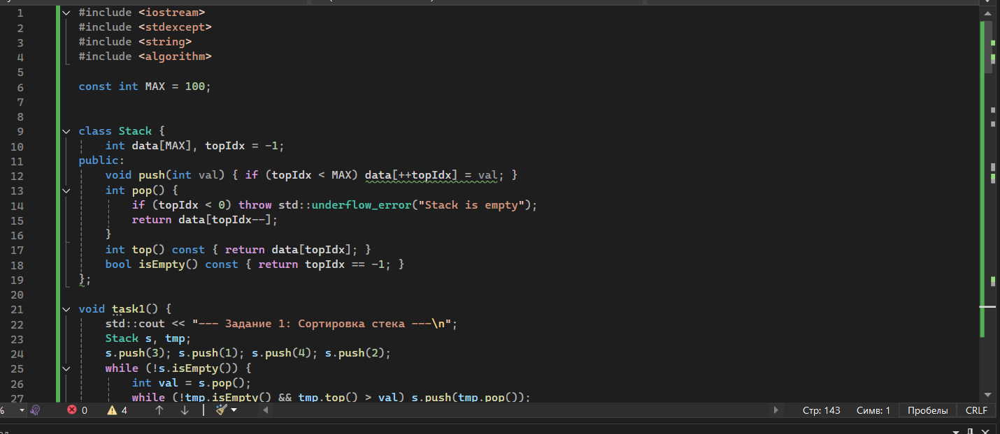
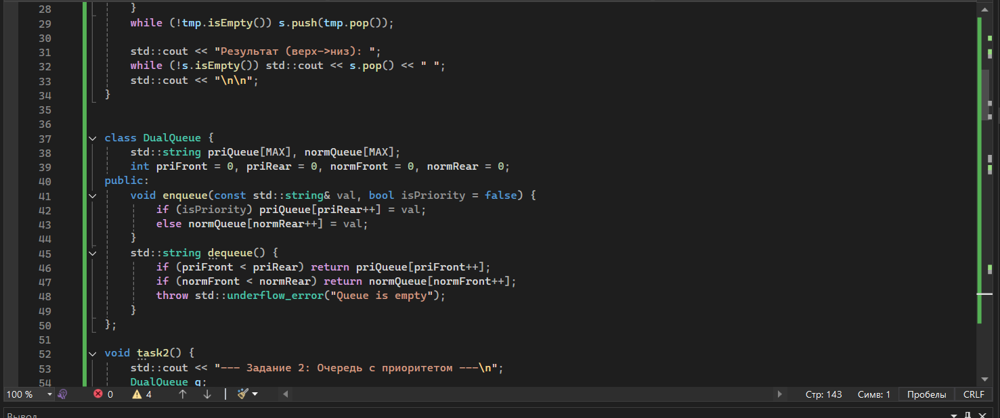
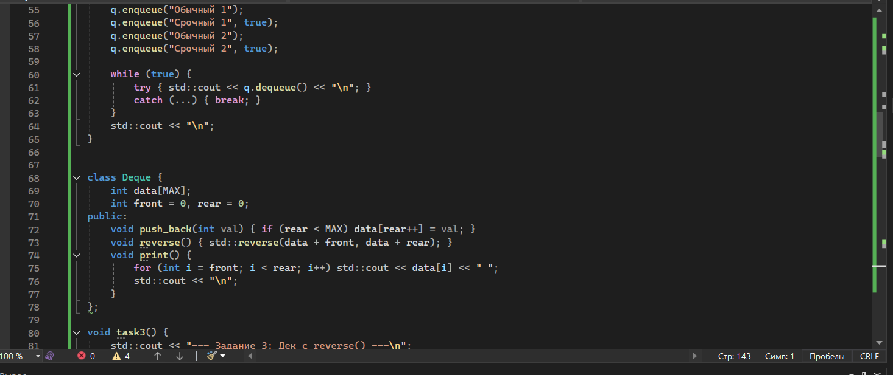
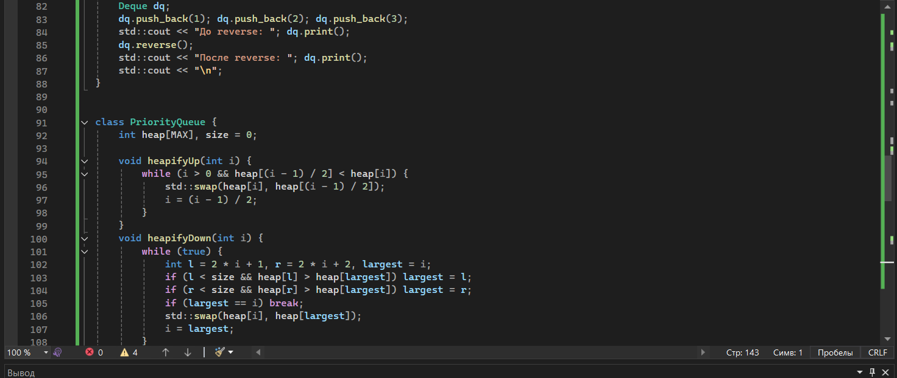
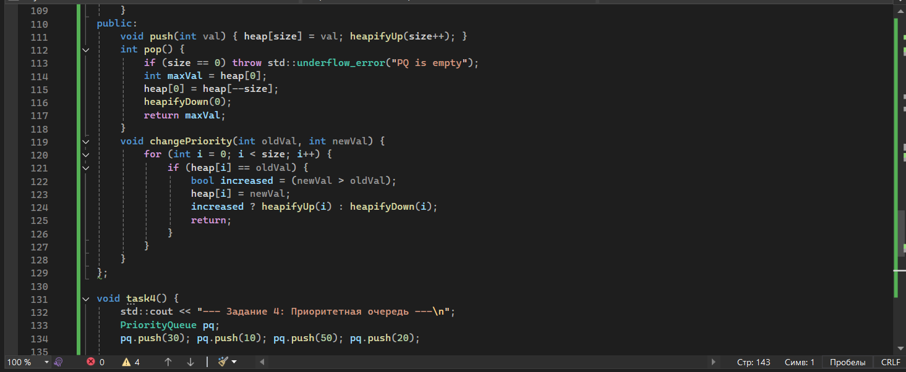
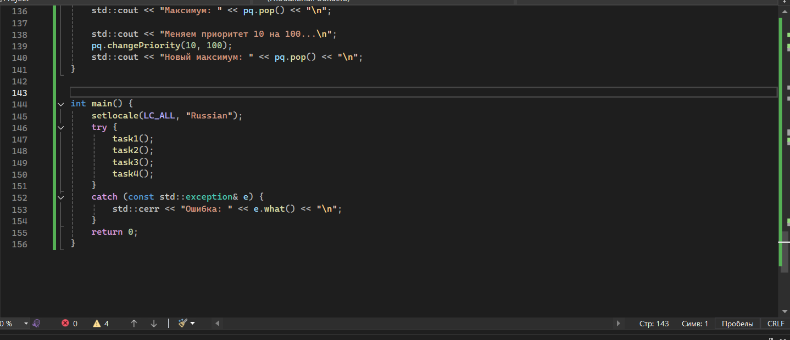
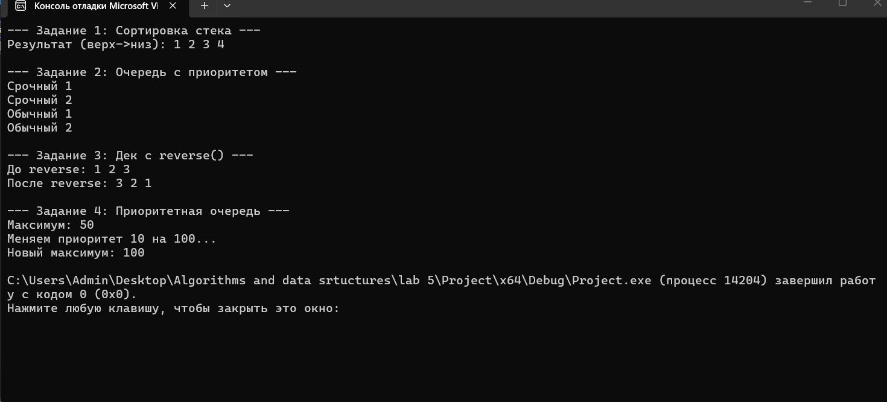

МИНИCTEPCTBO НАУКИ И ВЫСШЕГО ОБРАЗОВАНИЯ РОССИЙСКОЙ ФЕДЕРАЦИИ
Федеральное государственное автономное
образовательное учреждение высшего образования
«СЕВЕРО-КАВКАЗСКИЙ ФЕДЕРАЛЬНЫЙ УНИВЕРСИТЕТ»
Институт перспективной инженерии
Департамент цифровых, робототехнических систем и электроники
Межинститутская базовая кафедра 

Отчет по лабораторной работе № 5
Вариант 6
Тема: «Стек, очередь, дек, приоритетная очередь»
Дисциплина: «Алгоритмы и структуры данных»

Выполнил: 
Студент группы ПИЖ-б-о-25-2 (1),
направление подготовки: 09.03.04 «Программная инженерия»
Гетогазов Мухаммад Умарович 
Проверил: 
Ассистент межинститутской базовой кафедры ДЦРСиЭ 
Белик.А.И

Ставрополь 2025 

Код задания 
#include <iostream>
#include <stdexcept>
#include <string>
#include <algorithm> 

const int MAX = 100; 

class Stack {
    int data[MAX], topIdx = -1;
public:
    void push(int val) { if (topIdx < MAX) data[++topIdx] = val; }
    int pop() {
        if (topIdx < 0) throw std::underflow_error("Stack is empty");
        return data[topIdx--];
    }
    int top() const { return data[topIdx]; }
    bool isEmpty() const { return topIdx == -1; }
};

void task1() {
    std::cout << "--- Задание 1: Сортировка стека ---\n";
    Stack s, tmp;
    s.push(3); s.push(1); s.push(4); s.push(2); 
    while (!s.isEmpty()) {
        int val = s.pop();
        while (!tmp.isEmpty() && tmp.top() > val) s.push(tmp.pop()); 
    }
    while (!tmp.isEmpty()) s.push(tmp.pop()); 

    std::cout << "Результат (верх->низ): ";
    while (!s.isEmpty()) std::cout << s.pop() << " ";
    std::cout << "\n\n";
}

class DualQueue {
    std::string priQueue[MAX], normQueue[MAX]; 
    int priFront = 0, priRear = 0, normFront = 0, normRear = 0;
public:
    void enqueue(const std::string& val, bool isPriority = false) {
        if (isPriority) priQueue[priRear++] = val;
        else normQueue[normRear++] = val;
    }
    std::string dequeue() {
        if (priFront < priRear) return priQueue[priFront++];
        if (normFront < normRear) return normQueue[normFront++];
        throw std::underflow_error("Queue is empty");
    }
};

void task2() {
    std::cout << "--- Задание 2: Очередь с приоритетом ---\n";
    DualQueue q;
    q.enqueue("Обычный 1");
    q.enqueue("Срочный 1", true);
    q.enqueue("Обычный 2");
    q.enqueue("Срочный 2", true);

    while (true) {
        try { std::cout << q.dequeue() << "\n"; }
        catch (...) { break; } 
    }
    std::cout << "\n";
}

class Deque {
    int data[MAX];
    int front = 0, rear = 0; 
public:
    void push_back(int val) { if (rear < MAX) data[rear++] = val; }
    void reverse() { std::reverse(data + front, data + rear); } 
    void print() {
        for (int i = front; i < rear; i++) std::cout << data[i] << " ";
        std::cout << "\n";
    }
};

void task3() {
    std::cout << "--- Задание 3: Дек с reverse() ---\n";
    Deque dq;
    dq.push_back(1); dq.push_back(2); dq.push_back(3);
    std::cout << "До reverse: "; dq.print();
    dq.reverse();
    std::cout << "После reverse: "; dq.print();
    std::cout << "\n";
}

class PriorityQueue {
    int heap[MAX], size = 0;

    void heapifyUp(int i) {
        while (i > 0 && heap[(i - 1) / 2] < heap[i]) {
            std::swap(heap[i], heap[(i - 1) / 2]);
            i = (i - 1) / 2;
        }
    }
    void heapifyDown(int i) {
        while (true) {
            int l = 2 * i + 1, r = 2 * i + 2, largest = i;
            if (l < size && heap[l] > heap[largest]) largest = l;
            if (r < size && heap[r] > heap[largest]) largest = r;
            if (largest == i) break;
            std::swap(heap[i], heap[largest]);
            i = largest;
        }
    }
public:
    void push(int val) { heap[size] = val; heapifyUp(size++); }
    int pop() {
        if (size == 0) throw std::underflow_error("PQ is empty");
        int maxVal = heap[0];
        heap[0] = heap[--size];
        heapifyDown(0);
        return maxVal;
    }
    void changePriority(int oldVal, int newVal) {
        for (int i = 0; i < size; i++) {
            if (heap[i] == oldVal) {
                bool increased = (newVal > oldVal);
                heap[i] = newVal;
                increased ? heapifyUp(i) : heapifyDown(i);
                return;
            }
        }
    }
};

void task4() {
    std::cout << "--- Задание 4: Приоритетная очередь ---\n";
    PriorityQueue pq;
    pq.push(30); pq.push(10); pq.push(50); pq.push(20);

    std::cout << "Максимум: " << pq.pop() << "\n"; 

    std::cout << "Меняем приоритет 10 на 100...\n";
    pq.changePriority(10, 100);
    std::cout << "Новый максимум: " << pq.pop() << "\n"; 
}

int main() {
    setlocale(LC_ALL, "Russian");
    try {
        task1();
        task2();
        task3();
        task4();
    }
    catch (const std::exception& e) {
        std::cerr << "Ошибка: " << e.what() << "\n";
    }
    return 0;
}

Скрины кода 

Контрольные вопросы 
1. В чём заключается принцип работы стека (LIFO)?
Принцип LIFO (Last In, First Out — «последним пришёл, первым вышел»). Стек работает как стопка тарелок: мы можем добавлять (push) и забирать (pop) элементы только с одного конца — вершины. Тот элемент, который был добавлен последним, будет извлечён первым.

2. В чём заключается принцип работы очереди (FIFO)?
Принцип FIFO (First In, First Out — «первым пришёл, первым вышел»). Очередь работает как очередь в магазине: элементы добавляются в конец (хвост), а извлекаются из начала (головы). Элемент, добавленный первым, будет извлечён первым.

3. Чем дек отличается от обычной очереди?
Дек (Deque — Double-Ended Queue) — это двусторонняя очередь. От обычной очереди он отличается тем, что позволяет добавлять и удалять элементы с обоих концов (и с начала, и с конца), а не только с разных концов.

4. Что такое приоритетная очередь? Где она применяется?
Это структура данных, где каждый элемент имеет свой «приоритет». Извлечение элементов происходит не по времени добавления, а по их приоритету: первым извлекается элемент с наивысшим приоритетом.
Где применяется:

Алгоритмы поиска кратчайшего пути (алгоритм Дейкстры).

Планировщики задач в операционных системах (сначала выполняются задачи с высоким приоритетом).

Алгоритм сжатия Хаффмана.

Системы обработки событий.

5. Как реализовать стек на основе динамического массива?
Нужен массив и переменная top (указывает на индекс вершины, изначально -1).

Push: Увеличиваем top на 1 и записываем элемент в array[top]. Если массив заполнен — создаём новый массив в 2 раза больше и копируем туда старые элементы.

Pop: Берём элемент из array[top] и уменьшаем top на 1.

6. Как реализовать очередь на основе кольцевого буфера?
Используется массив фиксированного размера и два указателя: head (начало) и tail (конец).

При добавлении (enqueue) элемент пишется на позицию tail, а tail сдвигается: tail = (tail + 1) % capacity.

При извлечении (dequeue) элемент берётся с позиции head, а head сдвигается: head = (head + 1) % capacity.
Операция % (остаток от деления) позволяет указателям «закольцовываться» и переиспользовать пустые ячейки в начале массива.

7. Почему приоритетную очередь обычно реализуют на куче?
Потому что двоичная куча (binary heap) обеспечивает оптимальный баланс сложности операций. Вставка нового элемента и извлечение максимального/минимального элемента занимают O(log N), а получение элемента с наивысшим приоритетом (просмотр без извлечения) — O(1).
Если использовать обычный массив, вставка будет O(1), а поиск максимума O(N). Если использовать отсортированный массив — поиск O(1), но вставка O(N). Куча — золотая середина.

8. Какова сложность операций push и pop в стеке?
Push (добавление): O(1). (Для динамического массива — амортизированное O(1), так как иногда требуется расширение массива).

Pop (извлечение): O(1).

9. Какова сложность операций enqueue и dequeue в очереди?
При правильной реализации (на двусвязном списке или кольцевом буфере):

Enqueue (добавление): O(1).

Dequeue (извлечение): O(1).

10. Какова сложность операций в приоритетной очереди? Почему?
Insert (вставка): O(log N).

Extract Max/Min (извлечение): O(log N).

Peek (просмотр корня): O(1).
Почему: Из-за использования двоичной кучи. При вставке элемент «всплывает» наверх (высота дерева log N), при извлечении — последний элемент ставится на место корня и «проседает» вниз (высота дерева log N).

11. Как проверить правильность расстановки скобок с помощью стека?
Идём по строке слева направо.

Если встречаем открывающую скобку (, [ или { — кладём её в стек.

Если встречаем закрывающую скобку:

Проверяем вершину стека. Если стек пуст или верхняя скобка не соответствует текущей (например, в стеке (, а встретили ]) — ошибка.

Если соответствует — извлекаем её из стека (pop).

В конце проверки стек должен быть пуст. Если остались элементы — значит, остались незакрытые скобки.

12. Как реализовать очередь на двух стеках? Какова сложность?
Нужно два стека: in_stack (для добавления) и out_stack (для извлечения).

Enqueue: Просто кладём элемент в in_stack.

Dequeue: Если out_stack пуст, перекладываем в него все элементы из in_stack (они поменяют порядок на противоположный, что нам и нужно) и извлекаем верхний из out_stack. Если out_stack не пуст — просто извлекаем из него.

Сложность: Амортизированная O(1) на операцию (в худшем случае одна операция dequeue может занять O(N), но в среднем на каждую операцию приходится O(1), так как каждый элемент перекладывается ровно один раз).

13. Как реализовать дек на основе двусвязного списка?
Двусвязный список идеален для дека, так как имеет указатели на head (голова) и tail (хвост), а каждый узел хранит ссылки на следующий и предыдущий элементы.

Добавление в начало/конец: Меняем указатели head или tail и перепривязываем ссылки соседних узлов.

Удаление из начала/конца: Аналогично, перепривязываем указатели head или tail.
Все операции занимают O(1), так как не нужно сдвигать элементы или искать нужный узел.

